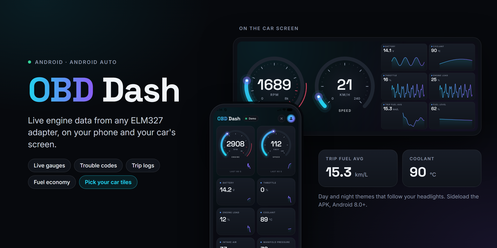
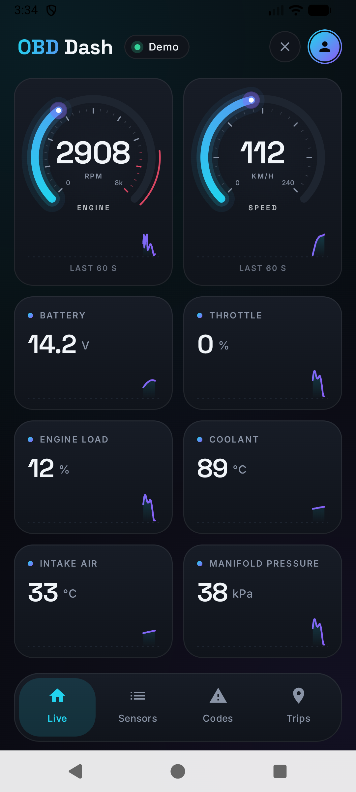
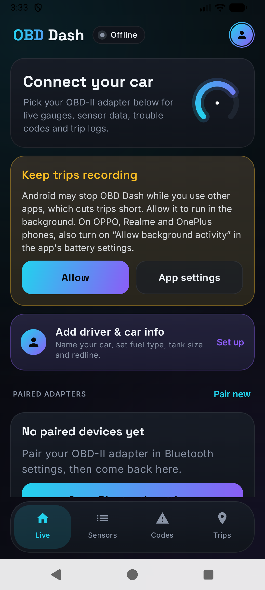
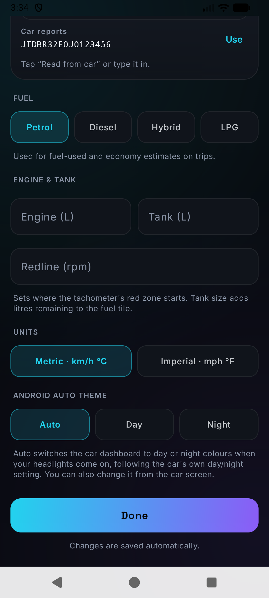
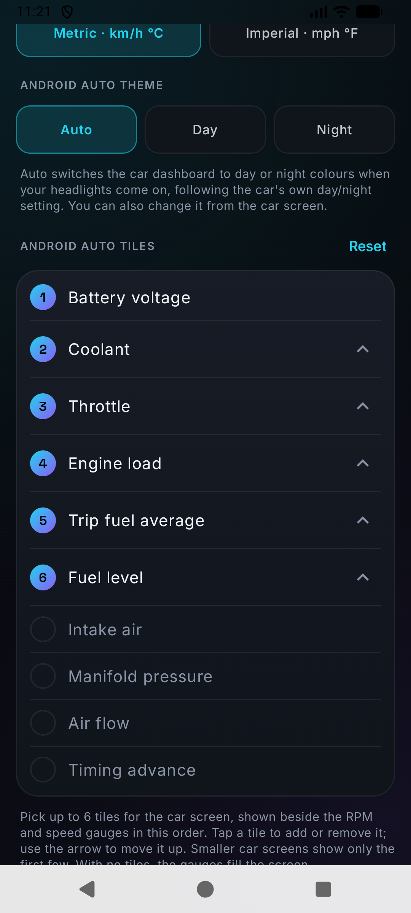
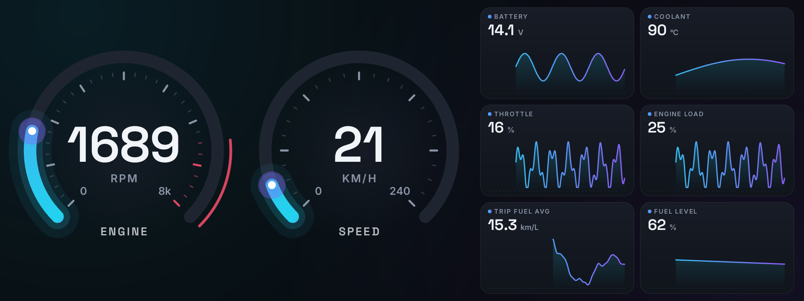
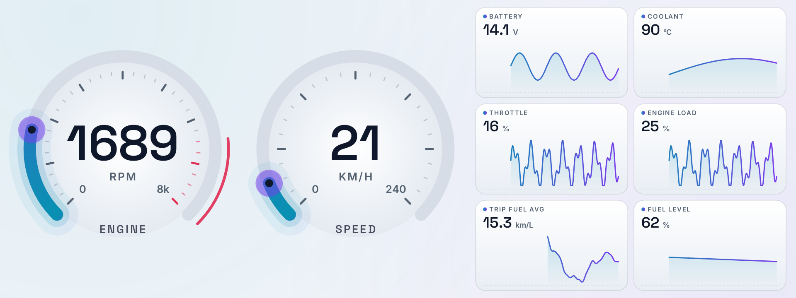

<p align="center">
  
</p>

# OBD Dash

An Android dashboard for Bluetooth ELM327 OBD-II adapters, built with Kotlin and Jetpack Compose.

<details>
<summary><b>Screenshots</b> (phone and Android Auto)</summary>

### Phone
<p>
  
  
  
  
</p>

### Android Auto
The tiles shown here were picked under **Profile → Android Auto tiles**, with the trip fuel average in place of intake air.

**Night**



**Day**



*Screenshots are from the emulator in Demo mode. The Android Auto images show the dashboard drawn by the car renderer, without Android Auto's own frame and buttons.*

</details>

## Features
- Connects to **paired** Bluetooth Classic (SPP) ELM327 adapters, including cheap clones (it falls back to RFCOMM channel 1)
- Large animated arc gauges for **RPM** (red zone from 6500) and **Speed**
- Tiles for battery voltage, throttle, engine load, coolant, intake air, manifold pressure, MAF, timing advance and fuel level, each with a range bar and warning colours, plus a live **trip fuel average** (km/L or mpg, estimated from the MAF sensor, shown after the first 0.5 km)
- Asks the car which PIDs it supports and hides the tiles it doesn't support
- Switches between km/h and °C or mph and °F (the choice is saved)
- Reconnects automatically to the last adapter you used
- **Trouble codes** tab: shows whether the check-engine light is on, lists stored (mode 03) and pending (mode 07) codes with descriptions, and can clear codes (mode 04) after asking you to confirm
- **Trips** tab: a trip is recorded automatically each time you connect, with distance, duration, average and max speed, max RPM, and fuel used and economy estimated from the MAF sensor. Each trip keeps a once-a-second CSV log you can export through the share sheet. The current trip is saved every 30 s so a crash doesn't lose it
- Demo mode with a simulated drive (plus sample trouble codes), so you can try it without a car
- Layouts for portrait and landscape, a dark theme, and the screen stays on while the app is open

## Install
Download `OBD-Dash.apk` from the [latest release](https://github.com/bilalhq/OBD-Dash/releases/latest) and install it with **KingInstaller**. Android 8.0 or later.

> [!IMPORTANT]
> Install the APK with **KingInstaller**, not by opening it from your file manager or browser. Otherwise **Android Auto won't show OBD Dash** on the car screen. The phone app works either way.

## Build & run
1. Install **Android Studio** (any recent version).
2. Choose **File → Open** and select this folder. Let Gradle sync; it downloads Gradle 8.11.1, AGP 8.7.3 and the SDK 35 platform the first time.
3. Turn on USB debugging on your phone, plug it in and press **Run ▶**.
   Or use **Build → Build App Bundle(s)/APK(s) → Build APK(s)** to get an APK you can sideload.
   Installing from Android Studio is fine for the phone app, but for Android Auto install the built APK with **KingInstaller** (see [Install](#install)).

Minimum Android version: 8.0 (API 26).

## Using it
1. Plug the adapter into the car's OBD-II port and turn the ignition on.
2. Pair the adapter in Android **Settings → Bluetooth**. The PIN is usually `1234` or `0000`.
3. Open OBD Dash, allow the Nearby devices permission, and tap your adapter.

## Android Auto
The car screen shows the RPM and speed gauges plus six sensor tiles with running graphs. Its buttons are Codes (read-only), Connect, Demo, units and theme.

**Tiles:** under **Profile → Android Auto tiles** on the phone, choose up to six tiles (battery voltage, coolant, throttle, load, intake air, manifold pressure, MAF, timing advance, fuel level, trip fuel average) and their order. Tiles the car doesn't report are skipped. With fewer tiles, each one gets bigger, and with none the gauges fill the screen. **Reset** goes back to the default six.

**Day/night theme:** in **Auto** (the default), the car screen switches between light and dark colours when your headlights come on, following the car's own day/night signal. You can also force **Day** or **Night**, either with the theme button on the car screen or under **Profile → Android Auto theme** on the phone.

It's registered as a *navigation* app because that's the only kind of Android Auto app allowed to draw its own screen. Two consequences:
- Opening it on the car screen replaces Google Maps, since only one navigation app can be active at a time.
- It can't be published on the Play Store; it's for sideloading only.

To enable it:
1. Make sure OBD Dash was installed with **KingInstaller** (see [Install](#install)). If it wasn't, uninstall it and install the APK again with KingInstaller.
2. On the phone, open **Android Auto settings**, scroll down and tap **Version** 10 times to unlock developer settings.
3. Open the **⋮ menu → Developer settings** and turn on **Unknown sources**.
4. Connect to the car. OBD Dash appears in the app launcher.

Before the first drive, open the phone app once and connect to your adapter. After that, the car screen connects to it automatically.

The phone app and the car share a single connection (`ObdController`, owned by `ObdApp`).

## Project layout
```
app/src/main/java/com/obddash/
  MainActivity.kt        entry point (keeps the screen on)
  ObdApp.kt              Application; owns the shared ObdController
  ObdController.kt       connection lifecycle, polling loop, demo simulator, codes, trips
  car/                   Android Auto: service, gauge screen (Canvas renderer), codes list
  obd/Elm327.kt          Bluetooth socket and ELM327 command I/O, init sequence
  obd/ObdParser.kt       response parsing (PIDs, supported-PID bitmasks, ATRV)
  obd/Pid.kt             PID definitions and decoders (add new PIDs here)
  obd/Dtc.kt             trouble-code parsing (CAN and non-CAN) and descriptions
  trips/Trips.kt         Trip model, JSON store, recorder and CSV logger
  ui/App.kt              permissions, navigation, top bar, connect screen
  ui/CodesScreen.kt      trouble codes tab
  ui/TripsScreen.kt      trip history tab
  ui/Common.kt           shared cards and unit formatting
  ui/Dashboard.kt        dashboard layout and stat tiles
  ui/Gauge.kt            arc gauge drawn on a Canvas
```

To add a new reading, add an entry to `Pid` with its mode-01 code, range and decode formula. It appears as a tile automatically.

## Limitations
- Fuel figures are estimates. They assume petrol (air-fuel ratio 14.7) and are blank on cars without a MAF sensor. Diesel figures will be wrong.
- If the Bluetooth connection drops in the middle of a drive, the trip is split into two.
- Code descriptions cover common generic codes. Manufacturer-specific codes only show their category.
- Adapters that only support BLE (some Vgate iCar Pro BLE or OBDLink CX models) need a separate BLE transport. Classic and "dual mode" adapters work.
- Polling speed depends on the adapter. Cheap clones manage about 5–10 readings per second, so RPM, speed and throttle are polled every cycle and the other readings take turns.
